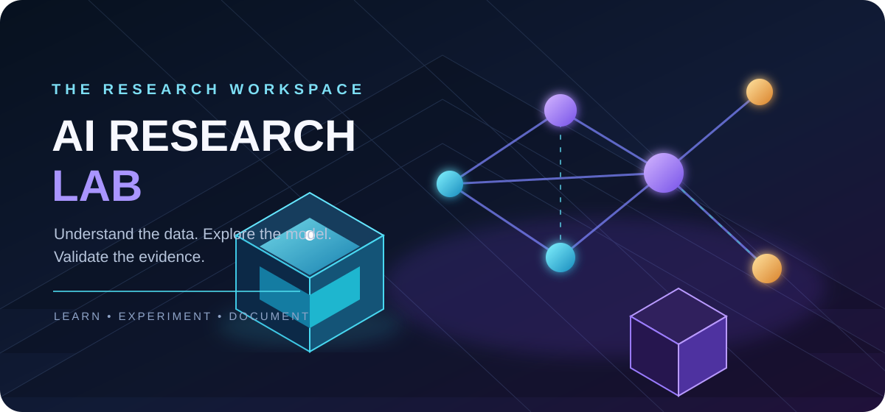
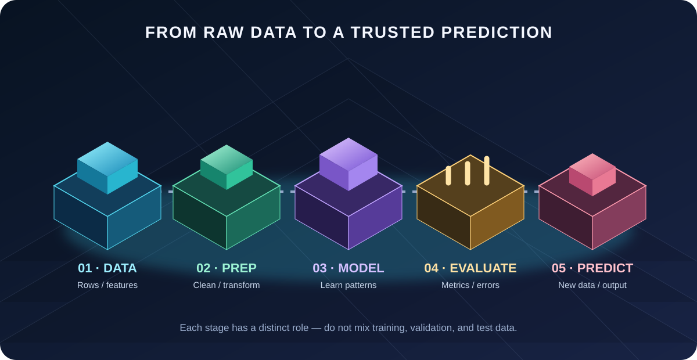
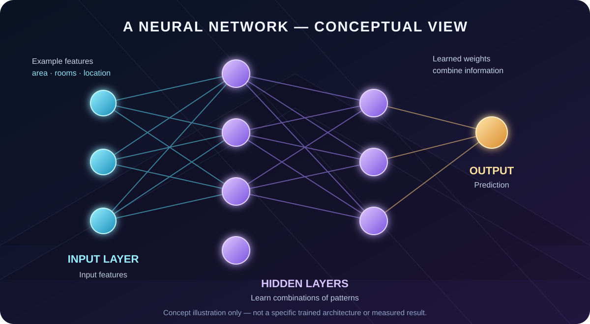

<div align="center">


<a href="https://github.com/Tejas-c-0/AI-Research-Lab"></a>

<p>
  
  
  
  
</p>



<p>
  <a href="./LEARNING_PATH.md"></a>
  <a href="./book/BOOK_BLUEPRINT.md"></a>
  <a href="https://tejas-c-0.github.io/AI-Research-Lab/3d-explorer/"></a>
</p>

</div>

---

## ✦ About

A structured workspace for learning, experimenting with, and documenting AI. Not just notes, but a path from **fundamentals → experiments → evidence**.

> **Core principle:** Understand the problem before the model. Understand the data before training. Evaluate evidence before making claims.

## 🧬 Interactive 3D Explorer

<a href="https://tejas-c-0.github.io/AI-Research-Lab/3d-explorer/">
  
</a>

**[Launch the explorer →](https://tejas-c-0.github.io/AI-Research-Lab/3d-explorer/)** Three live Three.js scenes: a **neural network**, a **research pipeline**, and a **dataset**. Drag to rotate, scroll to zoom, click any object to learn what it is.

## 📖 Learning Notes

| # | Note | You will learn |
|:-:|---|---|
| 01 | [AI Research Foundations](./AI%20Research%20Foundations.md) | Problems, gaps, hypotheses, experiments |
| 02 | [Structure of a Research Paper](./Structure%20of%20a%20Research%20Paper.md) | What each paper section does |
| 03 | [Reading and Analysing a Research Paper](./Reading%20and%20Analysing%20a%20Research%20Paper.md) | Method, evidence, limitations |
| 04 | [Understanding Data and Model Evaluation](./Understanding%20Data%20and%20Model%20Evaluation.md) | Datasets, train/test, metrics |
| 05 | [Types of Data, Features and Targets](./Types%20of%20Data%2C%20Features%20and%20Targets.md) | Numerical vs categorical, features, targets |
| 06 | [Understanding Data Cleaning](./Understanding%20Data%20Cleaning.md) | Missing, duplicate, invalid data |

📚 **Coming next:** [*Machine Learning Research: From Question to Evidence*](./book/BOOK_BLUEPRINT.md), a ~100-page beginner-friendly handbook on research questions, experiment design, evaluation, and reproducibility.

## 🧭 Roadmap

| Stage | Topics |
|:-:|---|
| 🐍 **01** | Python foundations, functions, modules, environments |
| 📊 **02** | NumPy, Pandas, Matplotlib, Seaborn, Jupyter |
| 🗃️ **03** | Data types, features and targets, cleaning, EDA |
| 📐 **04** | Linear algebra, probability, statistics, gradients |
| 🤖 **05** | Supervised and unsupervised learning, generalisation |
| 🌲 **06** | Linear and logistic regression, trees, forests, SVM, clustering |
| 🎯 **07** | Metrics, overfitting, cross-validation, data leakage |
| 🧠 **08** | Neural networks, backpropagation, CNNs, Transformers |
| 🔬 **09** | Research questions, baselines, reproducibility, paper reading |
| 🚀 **10** | Applied projects |

## 🌌 The Pipeline



| | Stage | Meaning |
|:-:|---|---|
| 🟦 | **Data** | Raw observations, features, inputs |
| 🟩 | **Preparation** | Cleaning, validation, transformation |
| 🟪 | **Model** | Algorithms and learned parameters |
| 🟨 | **Evaluation** | Metrics, error analysis, evidence |
| 🟥 | **Prediction** | Outputs and real-world use |

## 🧠 Neural Network, Visually



**Input** layer receives features → **hidden** layers learn patterns → **output** layer predicts. Weights are adjusted during training to reduce error.

<sub>Illustrative diagram only, not a trained model or measured result.</sub>

## 🔬 Experiment Rules

1. Start with a simple **baseline**.
2. Keep **train / validation / test** roles separate, and never tune on the test set.
3. Record datasets, preprocessing, parameters, and random seeds.
4. Compare methods under the **same protocol**.
5. Report failures too, and claim only what the evidence supports.

## ⚙️ Toolkit

<p>
  
  
  
  
  
  
  
</p>

<sub>Planned tools. Not all are configured in the repository yet.</sub>

## 🚀 Getting Started

```bash
git clone https://github.com/Tejas-c-0/AI-Research-Lab.git
cd AI-Research-Lab
```

## 👤 Maintainer

**Tejas C.** · [@Tejas-c-0](https://github.com/Tejas-c-0)

---

<div align="center">

**Learn the fundamentals. Question assumptions. Test ideas. Share reproducible work.**

<sub>Curiosity → Understanding → Experimentation → Evidence</sub>


</div>
