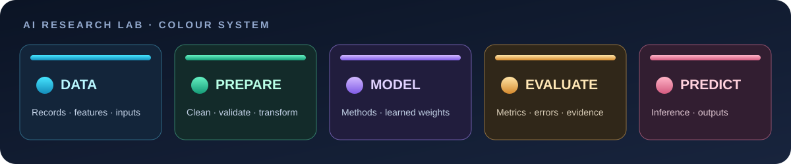

<!--
  AI Research Lab
  A structured workspace for learning, experimenting with, and documenting AI research.
-->

<div align="center">

# 🧠 AI Research Lab

### Learn deeply. Experiment carefully. Build evidence. Document everything.

<p>
  <strong>A personal, continuously evolving workspace for Artificial Intelligence, Machine Learning, Data Science, and research practice.</strong>
</p>

<p>
  <a href="https://github.com/Tejas-c-0/AI-Research-Lab">
    
  </a>
  
  
  
</p>

<p>
  <em>Not just notes. A disciplined path from fundamentals to reproducible experiments.</em>
</p>

</div>


<p align="center">
  
</p>

<p align="center">
  <strong>Explore the visual system:</strong> data → preparation → models → evaluation → prediction
</p>

---

## 🗺️ Your Research Learning Route

This repository is designed to be studied in a deliberate order. Start with the research process, learn how to read papers, understand data, and only then move into machine-learning concepts needed for experiments.

<p align="center">
  <a href="./LEARNING_PATH.md"></a>
  <a href="./book/BOOK_BLUEPRINT.md"></a>
  <a href="./3d-explorer/"></a>
</p>

### Existing learning notes

| Order | Markdown note | What it teaches |
|---:|---|---|
| 01 | [AI Research Foundations](./AI%20Research%20Foundations.md) | Research problems, gaps, hypotheses, and experiments |
| 02 | [Structure of a Research Paper](./Structure%20of%20a%20Research%20Paper.md) | The purpose and structure of each paper section |
| 03 | [Reading and Analysing a Research Paper](./Reading%20and%20Analysing%20a%20Research%20Paper.md) | Analysing problem, objective, method, evidence, and limitations |
| 04 | [Understanding Data and Model Evaluation](./Understanding%20Data%20and%20Model%20Evaluation.md) | Datasets, training/testing, metrics, and model behaviour |
| 05 | [Types of Data, Features and Targets](./Types%20of%20Data%2C%20Features%20and%20Targets.md) | Numerical/categorical data, features, and target variables |
| 06 | [Understanding Data Cleaning](./Understanding%20Data%20Cleaning.md) | Missing, duplicate, invalid, and inconsistent data |

**[Open the full learning path →](./LEARNING_PATH.md)** — includes the study sequence, what to focus on, and completion checks.

### The 100-page research book

**[Machine Learning Research: From Question to Evidence](./book/BOOK_BLUEPRINT.md)**

A planned, approximately 100-page beginner-friendly handbook focused on literature review, research questions, essential ML foundations, experimental design, evaluation, reproducibility, writing, peer review, and publication. It is not a general catalogue of algorithms.

## ✦ About the Lab

**AI Research Lab** is a structured learning and experimentation workspace focused on understanding how intelligent systems are designed, trained, evaluated, and improved.

The goal is to move beyond copying code or memorising definitions. Each topic should build conceptual understanding, practical ability, and the habit of asking research-oriented questions.

This repository is intended to grow over time through:

- **Learning notes** — concise explanations, diagrams, examples, and key concepts.
- **Code experiments** — small, understandable implementations that test one idea at a time.
- **Data work** — dataset inspection, preparation, visualisation, and analysis.
- **Model studies** — training, evaluation, comparison, and error analysis.
- **Research reading** — structured analysis of papers, methods, results, and limitations.
- **Project work** — practical applications built from a sound understanding of the fundamentals.

> **Core principle:** Understand the problem before choosing the model. Understand the data before training. Evaluate evidence before making claims.

## 🎯 Mission

Build the foundations and research habits required to become a capable AI engineer.

### What this lab aims to develop

| Area | Intended capability |
|---|---|
| Programming | Write and understand Python independently |
| Data science | Inspect, clean, transform, and visualise data |
| Mathematics | Build intuition for the mathematics behind ML |
| Machine learning | Understand learning approaches and model behaviour |
| Experimentation | Design fair experiments and evaluate results |
| Research | Read papers critically and identify limitations |
| Engineering | Organise code, document decisions, and reproduce work |

## 🧭 Learning Roadmap

The roadmap follows a deliberate progression. Advanced algorithms are introduced only after the foundations needed to understand them.

### 01 — Programming Foundations

- Python syntax and fundamentals
- Variables, data types, operators, and control flow
- Functions, modules, and error handling
- Lists, tuples, sets, and dictionaries
- Files, packages, and virtual environments
- Writing readable, modular Python

### 02 — Python for Data Science

- NumPy — arrays and numerical operations
- Pandas — tables, Series, DataFrames, and data manipulation
- Matplotlib — plotting and visual communication
- Seaborn — statistical visualisation
- Jupyter notebooks and exploratory analysis

### 03 — Understanding Data

- What data and datasets represent
- Rows, columns, records, and variables
- Numerical and categorical data
- Features and target variables
- Data quality and data cleaning
- Missing values, duplicates, invalid values, and inconsistent entries
- Exploratory Data Analysis (EDA)

### 04 — Mathematics and Statistics

- Basic algebra and functions
- Vectors and matrices
- Descriptive statistics
- Probability and distributions
- Correlation and covariance
- Derivatives and gradient intuition
- Linear algebra concepts used in machine learning

### 05 — Artificial Intelligence and Machine Learning Foundations

- What AI, ML, and Deep Learning mean
- Learning from examples
- Supervised and unsupervised learning
- Features, targets, predictions, and labels
- Training, validation, and test data
- Generalisation and model evaluation

### 06 — Machine Learning Methods

Introduced after the foundations:

- Linear Regression
- Logistic Regression
- Decision Trees
- Random Forests
- Support Vector Machines
- Clustering methods
- Model selection and baseline comparison

### 07 — Model Evaluation and Improvement

- Regression and classification tasks
- Appropriate evaluation metrics
- Overfitting and underfitting
- Bias and variance intuition
- Cross-validation
- Data leakage
- Error analysis and model limitations


## 🧠 Neural Network — Visual Concept

A neural network can be understood as connected layers that transform input information into an output. Each connection has a learned weight; the network adjusts these weights during training to reduce its prediction error.

<p align="center">
  
</p>

| Layer | Role |
|---|---|
| Input layer | Receives the features supplied to the model |
| Hidden layers | Transform information and learn useful patterns |
| Output layer | Produces the model's prediction |

<sub>Illustrative concept diagram. It does not represent a trained model, specific architecture, or measured result.</sub>

### 08 — Deep Learning

- Neural network fundamentals
- Activation functions and loss functions
- Gradient descent and backpropagation
- Training workflows
- Convolutional Neural Networks
- Sequence models
- Transformers and attention

### 09 — Research Practice

- Research questions and problem formulation
- Literature review and research gaps
- Hypotheses and experimental design
- Datasets, baselines, and evaluation protocols
- Reading and analysing research papers
- Reproducibility, limitations, and responsible reporting

### 10 — Applied Projects

Use the foundations to build focused projects, document decisions, evaluate results, and communicate what was learned.

---


## 🧬 Interactive 3D Research Explorer

<p align="center">
  <a href="https://tejas-c-0.github.io/AI-Research-Lab/3d-explorer/">
    
  </a>
</p>

**[Launch the interactive 3D explorer →](https://tejas-c-0.github.io/AI-Research-Lab/3d-explorer/)**

The explorer has three live Three.js scenes:
- **Neural network:** inspect input, hidden, and output nodes.
- **Research pipeline:** explore data, preparation, model, evaluation, and prediction.
- **Dataset:** inspect rows, columns, feature values, and target values.

Drag to rotate, scroll or pinch to zoom, and select an object to read its explanation. This is a teaching visualisation, not a trained model or experiment result. See the [explorer source](./3d-explorer/index.html).

### One-time GitHub Pages setup

The interactive source is committed, but the public live URL needs Pages enabled once:

1. Open this repository's **Settings → Pages**.
2. Under **Build and deployment → Source**, select **GitHub Actions**.
3. Open **Actions → Deploy interactive 3D explorer to GitHub Pages** and rerun the latest workflow.
4. When the workflow succeeds, use the Launch link above.

The deployment workflow is [`.github/workflows/pages.yml`](./.github/workflows/pages.yml).

## 🌌 Visual Research Pipeline

The visual below uses a distinct colour for each stage. The colours are a navigation aid: they identify the role of each stage, not a ranking or a quality score.

<p align="center">
  
</p>

### Colour legend

<p align="center"></p>

| Stage | Meaning |
|---|---|
| **Cyan / blue** | Data, datasets, features, and inputs |
| **Emerald / green** | Cleaning, validation, and preprocessing |
| **Violet / purple** | Algorithms, models, and learned parameters |
| **Amber / gold** | Metrics, evaluation, and error analysis |
| **Coral / rose** | Predictions, inference, and outputs |

The swatches above are drawn with actual SVG colour fills, not text symbols. The same palette is used in the interactive 3D explorer.

## 🔬 Research Workflow

Each experiment should follow a traceable process:

<div align="center">

**Problem** → **Background Research** → **Question** → **Dataset**  
↓  
**Method** → **Experiment** → **Evaluation** → **Analysis**  
↓  
**Conclusion** → **Limitations** → **Next Experiment**

</div>

| Stage | Questions to answer |
|---|---|
| Problem | What exactly are we trying to solve? |
| Background | What is already known? |
| Research question | What do we want to investigate? |
| Data | Where did the data come from? Is it suitable? |
| Method | Why is this method appropriate? |
| Experiment | What was changed, and what was held constant? |
| Evaluation | Which metrics are appropriate, and why? |
| Analysis | What do the results actually show? |
| Limitations | What can we not conclude? |
| Next step | What should be tested next? |

### Experiment principles

1. Establish a simple baseline before adding complexity.
2. Keep training, validation, and test roles separate.
3. Never use test-set results to tune the model.
4. Record dataset sources, preprocessing, parameters, and random seeds where applicable.
5. Compare methods under the same evaluation protocol.
6. Report unsuccessful experiments as well as successful ones.
7. Do not claim improvement unless the evidence supports it.

## 📚 Research Paper Reading Framework

For every paper studied, record:

| Component | What to extract |
|---|---|
| Problem | Which problem does the paper address? |
| Objective | What does the work aim to achieve? |
| Related work | What have previous researchers tried? |
| Research gap | What limitation or unanswered question motivates the work? |
| Methodology | Which method, model, or approach is proposed? |
| Dataset | Which data is used, and how is it prepared? |
| Evaluation | Which metrics and baselines are used? |
| Results | What evidence is reported? |
| Limitations | What remains unresolved? |
| Takeaway | What did the paper contribute? |

**Reading rule:** Separate what the authors demonstrate from what you infer. A paper's claim is not automatically proof of general usefulness.

## 🗂️ Suggested Future Organisation

The actual current files are listed in the learning route above. As the repository grows, it can evolve toward this organisation:

```text
AI-Research-Lab/
│
├── README.md
│
├── 00-foundations/
│   ├── programming/
│   ├── python/
│   └── mathematics/
│
├── 01-data-science/
│   ├── numpy/
│   ├── pandas/
│   ├── visualisation/
│   └── data-cleaning/
│
├── 02-machine-learning/
│   ├── fundamentals/
│   ├── supervised-learning/
│   ├── unsupervised-learning/
│   └── evaluation/
│
├── 03-deep-learning/
│
├── 04-research/
│   ├── paper-notes/
│   ├── research-methods/
│   └── experiment-logs/
│
├── 05-projects/
│
├── datasets/
│   └── README.md
│
├── assets/
│   ├── diagrams/
│   └── images/
│
└── requirements.txt
```

This is a suggested organisation, not a claim that every directory or file has already been created.

### Current repository structure

```text
AI-Research-Lab/
├── README.md
├── LEARNING_PATH.md
├── AI Research Foundations.md
├── Structure of a Research Paper.md
├── Reading and Analysing a Research Paper.md
├── Understanding Data and Model Evaluation.md
├── Types of Data, Features and Targets.md
├── Understanding Data Cleaning.md
├── 01_data_problems.svg
├── 02_cleaning_workflow.svg
├── 03_before_after.svg
├── 3d-explorer/
│   └── index.html
├── book/
│   └── BOOK_BLUEPRINT.md
├── assets/
│   ├── hero-ai-research-lab.svg
│   ├── data-to-model-pipeline.svg
│   ├── neural-network-3d.svg
│   ├── colour-legend.svg
│   └── research_pipeline.svg
└── .github/workflows/pages.yml
```

## 📝 Learning Note Standard

Each learning note should be concise, accurate, and easy to revisit.

Suggested Markdown structure:

```markdown
# Topic Name

## 1. What is it?
A clear beginner-friendly definition.

## 2. Why is it needed?
The problem or purpose it addresses.

## 3. How does it work?
Explain the idea step by step.

## 4. Example
Use a small real-world or numerical example.

## 5. Key points
- Important concept
- Common mistake
- Practical takeaway

## 6. Practice
Questions or a small exercise to check understanding.

## References
Links to reliable documentation or research papers.
```

Use diagrams when they genuinely clarify a concept. Keep image files in a predictable location and use relative Markdown paths so notes remain portable.

## 🧪 Experiment Log Template

Every meaningful experiment should leave a record:

```text
Experiment ID:
Date:
Research question:
Dataset and source:
Target / objective:
Baseline:
Method:
Preprocessing:
Train / validation / test strategy:
Evaluation metrics:
Results:
Observations:
Limitations:
Next experiment:
Code / notebook:
```

Do not record only the final score. Preserve enough information to understand how the result was obtained.

## ⚙️ Tools and Technologies

The following are tools intended for use as the lab develops. Their presence in this list does not imply that every tool is already configured or used in the repository.

| Category | Tools |
|---|---|
| Language | Python |
| Data handling | NumPy, Pandas |
| Visualisation | Matplotlib, Seaborn |
| Machine learning | scikit-learn |
| Deep learning | PyTorch / TensorFlow |
| Development | VS Code, Jupyter |
| Version control | Git, GitHub |
| Documentation | Markdown |

## ✅ Progress Tracking

Progress should reflect completed work, not planned work.

- [ ] Python foundations
- [ ] NumPy fundamentals
- [ ] Pandas fundamentals
- [ ] Data visualisation
- [ ] Dataset understanding and cleaning
- [ ] Mathematics and statistics foundations
- [ ] AI and ML fundamentals
- [ ] Supervised learning
- [ ] Unsupervised learning
- [ ] Model evaluation
- [ ] Deep learning foundations
- [ ] Research paper analysis
- [ ] Reproducible experiments
- [ ] Applied projects

Update this checklist only when the relevant work is genuinely completed and documented.

## 🔄 Keeping the Learning Map in Sync

When a new lesson or research note is added:

1. Add the Markdown file to the **Existing learning notes** table in this README.
2. Add it to [`LEARNING_PATH.md`](./LEARNING_PATH.md) in the correct concept order, not merely by upload date.
3. Add a short purpose and a completion check so the reader knows what to learn before moving forward.
4. Update the suggested repository structure if folders or assets change.
5. Keep the research book blueprint separate; add a chapter only when the topic belongs in a research-methods handbook.

The learning map should show the actual files in the repository. Planned lessons must be labelled as planned, not presented as completed work.
## 🤝 Working Principles

- Learn concepts before relying on libraries.
- Write code independently before looking for a complete solution.
- Prefer small experiments over unexplained complexity.
- Use reliable sources and cite them in research notes.
- Respect dataset licences, privacy, and usage restrictions.
- Never fabricate metrics, citations, results, or research contributions.
- Explain failures and limitations honestly.
- Keep experiments reproducible wherever practical.

## 🚀 Getting Started

You can explore the repository's learning notes and experiments as they are added.

To work locally:

```bash
git clone https://github.com/Tejas-c-0/AI-Research-Lab.git
cd AI-Research-Lab
```

When Python experiments are added, use a virtual environment and install only the dependencies required by that experiment.

## 👤 Maintainer

**Tejas C.**

- GitHub: [@Tejas-c-0](https://github.com/Tejas-c-0)
- Repository: [AI-Research-Lab](https://github.com/Tejas-c-0/AI-Research-Lab)

## 📌 Vision

A strong AI engineer is not defined by the number of algorithms they can name. The real foundation is the ability to understand data, reason about methods, design experiments, evaluate evidence, and build systems that work.

**Learn the fundamentals. Question assumptions. Test ideas. Share reproducible work.**

---

<div align="center">

**AI Research Lab**  
<sub>Curiosity → Understanding → Experimentation → Evidence</sub>

</div>
