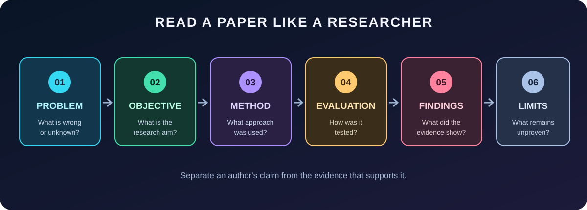

# 🧠 DAY 03 --- HOW TO READ AND ANALYSE AN AI RESEARCH PAPER {#brain-day-03--how-to-read-and-analyse-an-ai-research-paper}

> **Today\'s mission:** Stop reading research papers as ordinary
> articles. Learn to inspect the problem, method, evidence, and
> limitations like a researcher.



## 🧭 Learning map {#compass-learning-map}

By the end of this lesson, you should be able to:

-   [ ] Identify the problem a paper is trying to solve.
-   [ ] Separate the research objective from the research question.
-   [ ] Explain the method in your own words.
-   [ ] Identify the dataset, experiment, and evaluation metrics.
-   [ ] Interpret results without exaggerating what they prove.
-   [ ] Find limitations and formulate a possible research gap.

**Connection to previous days**

  Day          What you learned                                                                     How Day 3 uses it
  ------------ ------------------------------------------------------------------------------------ -------------------------------------------------------------
  Day 01       Problem, research gap, hypothesis, experiment                                        Helps you identify the logic behind a study
  Day 02       Title, abstract, introduction, literature review, methodology, results, conclusion   Helps you navigate the paper
  **Day 03**   **Critical reading and analysis**                                                    **Helps you evaluate what the paper actually demonstrates**

------------------------------------------------------------------------

# 1. The five questions to ask while reading {#1-the-five-questions-to-ask-while-reading}

A useful first pass through a paper is to answer five questions.

  Element          Ask yourself                              What to look for
  ---------------- ----------------------------------------- -----------------------------------------
  **Problem**      What is not working or not known?         The issue, limitation, or challenge
  **Objective**    What are the authors trying to achieve?   The stated aim of the study
  **Method**       What did they do?                         Model, algorithm, dataset, procedure
  **Evaluation**   How did they test it?                     Baselines, metrics, test data, protocol
  **Findings**     What did they discover?                   Results, comparisons, limitations

> 🟩 **Researcher habit:** Do not accept a paper\'s headline claim
> immediately. Trace the claim back to the experiment and evidence that
> support it.

## Problem ≠ objective ≠ research question {#problem--objective--research-question}

-   **Problem:** The machine-learning model performs poorly on unseen
    house records.
-   **Objective:** Improve the model\'s ability to predict prices for
    unseen houses.
-   **Research question:** Does adding location-related features improve
    prediction error on a held-out test set?

These statements are related, but they are not interchangeable.

------------------------------------------------------------------------

# 2. Practical case study --- House-price prediction {#2-practical-case-study--house-price-prediction}

This is a **hypothetical teaching example**, not a published study and
not a real experimental result.

## Scenario

A researcher trains a machine-learning model using **500 house
records**. The model performs very well on training data but performs
poorly on unseen houses.

### Step A --- Define the problem {#step-a--define-the-problem}

The model has a large performance gap between training data and unseen
data. The central concern is **generalization**.

**Generalization** is a model\'s ability to perform well on examples
that were not used to train it.

### Step B --- List possible explanations {#step-b--list-possible-explanations}

Do not assume the cause from one observation. Investigate several
hypotheses.

  Possible cause            What it means                                         What you could inspect
  ------------------------- ----------------------------------------------------- ------------------------------------------
  **Overfitting**           The model fits training-specific patterns or noise    Training vs. validation/test performance
  **Limited data**          500 records may not represent the variety of houses   Dataset size and coverage
  **Distribution shift**    New houses differ from training examples              Feature and target distributions
  **Missing features**      Important predictors are absent                       Available features and domain knowledge
  **Data quality issues**   Records contain errors or inconsistent values         Missing values, duplicates, outliers


### Step C --- Form a testable hypothesis {#step-c--form-a-testable-hypothesis}

Example hypothesis:

> A less complex model will reduce the gap between training and test
> error compared with an overly complex model.

This is testable because you can train models with different complexity
and compare their errors on the same held-out data.

**Variables in this example**

-   Independent variable: Model complexity.
-   Dependent variable: Prediction error on held-out data.
-   Controlled conditions: Same dataset split, target definition, and
    evaluation procedure.

------------------------------------------------------------------------

# 3. Design an experiment --- Do not just say \"use more data\" {#3-design-an-experiment--do-not-just-say-use-more-data}

A research experiment must specify what you will do and how you will
compare outcomes.


## A defensible baseline workflow

1.  Inspect the 500 records for missing values, duplicates, and obvious
    data problems.
2.  Define the target variable: house price.
3.  Split the data into training, validation, and test sets.
4.  Fit preprocessing steps using training data only.
5.  Train a simple baseline model.
6.  Evaluate on validation data while selecting model settings.
7.  Evaluate the final selected model on the held-out test set.
8.  Record the metrics and the exact experimental setup.
9.  Repeat with different random seeds or suitable cross-validation to
    check stability.

### Why separate the data?

  Split        Purpose
  ------------ ----------------------------------------------------------------
  Training     Fit model parameters
  Validation   Select settings and compare candidate models
  Test         Estimate performance on data kept aside until final evaluation

⚠️ **Data leakage warning:** Do not use test-set information to fit
preprocessing, choose features, or tune model settings. Doing so can
make test performance look better than it really is.

## Example experiment log

  Run   Model                           Training MAE        Test MAE Notes
  ----- ---------------------------- --------------- --------------- ----------------------------
  1     Baseline linear regression     Record result   Record result Initial reference
  2     Regularized regression         Record result   Record result Compare complexity control
  3     Tree-based model               Record result   Record result Compare nonlinear patterns

**Do not fill these with invented values.** Run the experiments and
enter the actual results.

------------------------------------------------------------------------

# 4. Evaluation metrics for house-price prediction {#4-evaluation-metrics-for-house-price-prediction}

House-price prediction is a **regression task** because the output is a
continuous numerical value.


## MAE --- Mean Absolute Error {#mae--mean-absolute-error}

The average absolute difference between actual and predicted values.

\[ MAE = \\frac{1}{n}\\sum\_{i=1}\^{n}\|y_i-\\hat{y}\_i\| \]

-   Easy to interpret.
-   Expressed in the same units as the target.
-   Lower is better.

**Example:** If actual price is ₹50 lakh and predicted price is ₹45
lakh, absolute error is ₹5 lakh.

## MSE --- Mean Squared Error {#mse--mean-squared-error}

\[ MSE = \\frac{1}{n}\\sum\_{i=1}\^{n}(y_i-\\hat{y}\_i)\^2 \]

-   Squares each error.
-   Large errors receive much greater weight.
-   Lower is better.

## RMSE --- Root Mean Squared Error {#rmse--root-mean-squared-error}

\[ RMSE = \\sqrt{\\frac{1}{n}\\sum\_{i=1}\^{n}(y_i-\\hat{y}\_i)\^2} \]

-   Expressed in the same units as the target.
-   Penalizes large errors more strongly than MAE.
-   Lower is better.

## R² --- Coefficient of determination {#r²--coefficient-of-determination}

R² compares the model with a simple baseline that predicts the mean
target value.

-   Often ranges from 0 to 1 in common settings, but can be negative on
    test data.
-   Higher is generally better.
-   It is not the percentage of predictions that are correct.

### Which metric should you choose?

  Situation                                                    Useful metric
  ------------------------------------------------------------ ---------------
  Want average absolute price error                            MAE
  Want to penalize large errors                                RMSE
  Want a squared-error measure                                 MSE
  Want to compare explained variance against a mean baseline   R²

❌ **Do not use Precision@K for ordinary house-price regression.**
Precision@K is commonly used in ranking and recommendation tasks, where
the goal is to identify relevant items near the top of a ranked list.

------------------------------------------------------------------------

# 5. Interpret results carefully {#5-interpret-results-carefully}

Imagine a hypothetical experiment reports:

  Metric     Training   Test
  -------- ---------- ------
  R²             0.98   0.52

This large difference is a warning sign. It may indicate overfitting,
but it does not prove overfitting by itself.

Ask:

1.  Were the training and test records split correctly?
2.  Are the two sets drawn from comparable distributions?
3.  Was preprocessing fitted only on training data?
4.  Were model settings selected without looking at the test set?
5.  Is the test set large and representative enough?


> 🟨 **Interpretation discipline:** A metric is evidence about
> performance under a particular evaluation setup. It is not a universal
> guarantee that the model will work in every real-world situation.

------------------------------------------------------------------------

# 6. Research gap --- move beyond \"the model is not accurate\" {#6-research-gap--move-beyond-the-model-is-not-accurate}

A research gap is an unanswered question or limitation supported by
reviewing existing work. It cannot be established just because you
personally have not seen a solution.

### Weak statement

\"The model is not good at predicting house prices.\"

This describes a problem, not a demonstrated research gap.

### More focused research question

\"How does training-set size affect the test MAE of house-price
prediction models on this dataset?\"

### Possible gap to investigate

\"After reviewing relevant studies, investigate whether the effect of
training-set size on generalization has been adequately evaluated for
the specific dataset or setting under consideration.\"

**Important:** You must review relevant papers before claiming this is
genuinely unexplored.

## Problem → question → evidence {#problem--question--evidence}

``` text
Observed problem
      ↓
Read existing studies
      ↓
Identify what remains uncertain
      ↓
Form a focused research question
      ↓
Design an experiment
      ↓
Collect and analyse evidence
      ↓
State a supported conclusion
```

------------------------------------------------------------------------

# 7. Research paper reading workflow {#7-research-paper-reading-workflow}

Use this sequence when you open a new paper.

  Pass   Read                         Your goal
  ------ ---------------------------- -----------------------------------------------
  1      Title and abstract           Understand the topic and claimed contribution
  2      Introduction                 Understand the problem and motivation
  3      Literature review            Understand prior work and claimed gap
  4      Methodology                  Understand the proposed approach
  5      Experiments and results      Inspect the evidence
  6      Limitations and conclusion   Understand what remains uncertain

### Reading rules

-   Do not try to understand every equation on the first pass.
-   Look up unfamiliar technical terms.
-   Write a one-sentence summary in your own words.
-   Separate what the authors claim from what their results demonstrate.
-   Record questions you cannot answer yet.

------------------------------------------------------------------------

# 8. Your reusable research-paper analysis template {#8-your-reusable-research-paper-analysis-template}

Copy this template for every paper you read.

``` markdown
# Research Paper Analysis

## Paper details
- Title:
- Authors:
- Publication year:
- Venue / journal:
- Paper link:

## 1. Problem
What problem are the authors addressing?

## 2. Objective
What are they trying to achieve?

## 3. Research question
What question does the study investigate?

## 4. Existing work
What have previous researchers done?

## 5. Research gap
What limitation or unanswered question do the authors identify?
Is the gap supported by the literature review?

## 6. Methodology
- Model / algorithm:
- Dataset:
- Features:
- Experimental setup:

## 7. Evaluation
- Baselines:
- Metrics:
- Data split:
- Validation procedure:

## 8. Results
What do the results actually show?

## 9. Limitations
What do the authors acknowledge?
What other limitations can you identify?

## 10. My understanding
Explain the paper in 5 simple sentences.

## 11. My questions
What do I still not understand?
```

------------------------------------------------------------------------

# 9. Knowledge checkpoint {#9-knowledge-checkpoint}

Try these without looking at the lesson. Use the checkboxes to track
completion.

-   [ ] I can distinguish problem, objective, and research question.
-   [ ] I can explain generalization and overfitting.
-   [ ] I can design a basic train/validation/test experiment.
-   [ ] I know when to use MAE, RMSE, MSE, and R².
-   [ ] I can explain why Precision@K is not suitable for ordinary
    regression.
-   [ ] I can distinguish a research problem from a research gap.
-   [ ] I can summarize a research paper in my own words.

```{=html}
<details>
<summary>🧩 Self-test — reveal the answers after trying</summary>
```
**1. A model performs very well on training data but poorly on test
data. What might be happening?**

Possible overfitting. Investigate the split, leakage, and distribution
differences before concluding.

**2. Which metric measures average absolute prediction error?**

MAE.

**3. Why should test data remain separate during model selection?**

To avoid using the final evaluation data to influence the model and
obtain an overly optimistic estimate.

**4. Is \"the model has low accuracy\" automatically a research gap?**

No. A gap needs evidence from reviewing existing research.

**5. Is Precision@K suitable for predicting a continuous house price?**

Not for ordinary regression. It is designed for ranked retrieval or
recommendation settings.

```{=html}
</details>
```

------------------------------------------------------------------------

# 10. Day 3 practical assignment {#10-day-3-practical-assignment}

**Your task:** Analyse one real machine-learning research paper related
to house-price prediction or recommendation systems.

Deliverables:

1.  Paper title and publication year.
2.  Problem and objective.
3.  Dataset and methodology.
4.  Evaluation metrics.
5.  Main findings.
6.  At least two limitations or unanswered questions.
7.  Your own five-sentence explanation.

**Do not use an AI-generated summary as your only understanding.** Read
the abstract, introduction, methodology, results, and conclusion
yourself.

------------------------------------------------------------------------

# 🏁 Day 3 completion criteria {#checkered_flag-day-3-completion-criteria}

You are ready for Day 4 when you can take a research paper and explain
its problem, method, evaluation, results, and limitations without
copying the abstract.

**Remember the research mindset:**

> Don\'t ask only, \"Did the model work?\" Ask, \"How do we know it
> worked, under what conditions, and what remains unanswered?\"

**NEURAL NOTES --- THINK · RESEARCH · BUILD**
