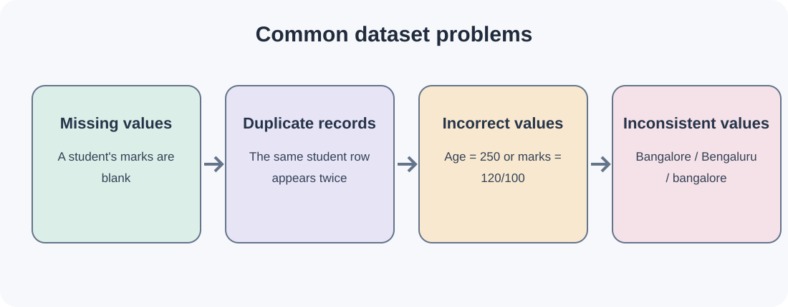
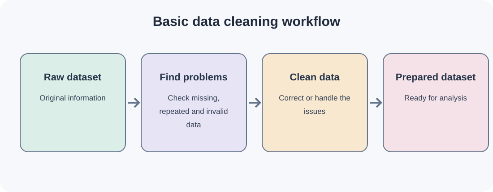
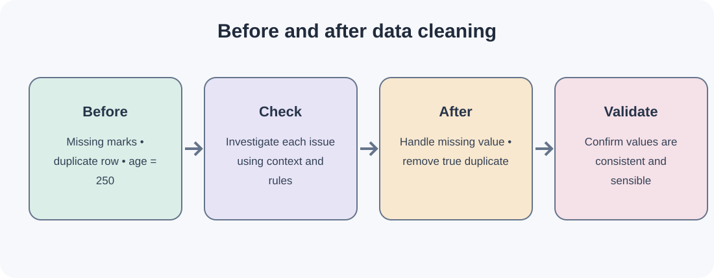

# Day 6 — Understanding Data Cleaning

## 1. What is Data Cleaning?

Data cleaning is the process of identifying and fixing incorrect, incomplete, duplicate or inconsistent data.

## 2. Common Data Problems

### A. Missing Values
Missing values occur when some information is not available in a dataset.

Example:

| Student | Marks |
|---|---:|
| A | 80 |
| B | 75 |
| C | Missing |

### B. Duplicate Records
Duplicate records occur when the same record appears more than once.

Example:

| Student | Age | Marks |
|---|---:|---:|
| A | 19 | 85 |
| B | 20 | 75 |
| A | 19 | 85 |

### C. Incorrect Values
Incorrect values are values that do not follow the expected rules of the dataset.

Examples:
- Age = 250 years.
- Marks = 120 when the maximum is 100.
- An incorrectly formatted phone number.

### D. Inconsistent Values
Inconsistent values occur when the same information is represented in different ways.

Example:
- Bangalore
- Bengaluru
- bangalore

## 3. How Do We Clean Data?

Common data-cleaning operations include:

- Identify missing values.
- Find and handle duplicate records.
- Correct invalid values.
- Standardise inconsistent information.
- Check whether the data is suitable for analysis.

## 4. Data Cleaning Workflow

Raw Dataset → Identify Problems → Clean Data → Prepared Dataset

## 5. Before and After Data Cleaning

Before cleaning:
- Missing marks.
- Duplicate student records.
- Incorrect age values.

After cleaning:
- Handle missing information.
- Remove genuine duplicate records.
- Correct invalid values after verification.
- Check data consistency.

## 6. Why Is Data Cleaning Important?

- Improves data quality.
- Prevents incorrect analysis.
- Helps prepare data for machine learning.
- Reduces errors caused by poor-quality information.
- Helps models learn from more reliable data.

## Practice Questions

1. What is data cleaning?
2. What are missing values?
3. What are duplicate records?
4. Give two examples of incorrect values.
5. What are inconsistent values?
6. Why is data cleaning important?